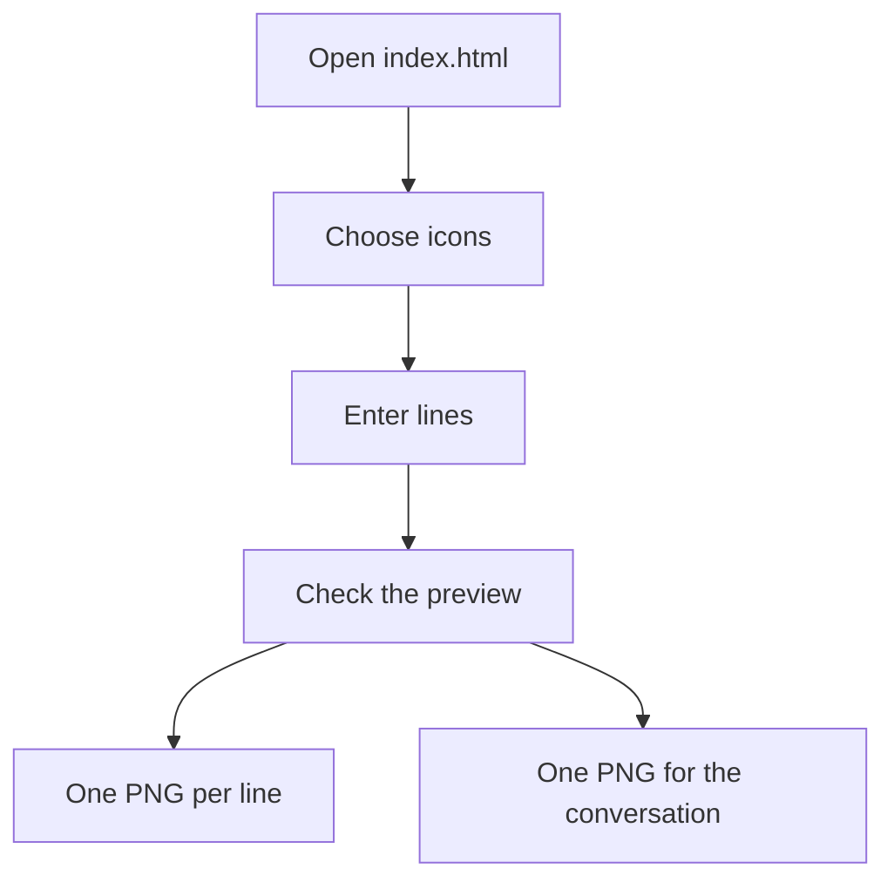

# Design

Status: **Accepted**

## Purpose

note articles have no speech bubbles. This tool makes images of a conversation between two speakers, so those images can be pasted into an article.

## Who uses it

The person writing the article. Readers see the saved PNG files on note.

## Shape

The app is the single file `index.html`. It runs when a browser opens that file. Nothing is installed. The lines, icons, and images are produced only in that browser.

## Speakers

| Speaker | Place | Bubble | Border | Name color | No icon |
| --- | --- | --- | --- | --- | --- |
| わたし (default, right) | Right, icon on the right | White `#FFFFFF` | Green `#4E7A3F`, 3px | `#3e6432` | First character of the name. Default わ |
| メェ助 (default, left) | Left, icon on the left | Cream `#FFFBF0` | Gold `#C99A3E`, 3px | `#6e4f1c` | First character of the name. Default メ |

The names can be edited on the page. The defaults are わたし on the right and メェ助 on the left. A new name is used under the icon and as the bulk-paste prefix. An empty field returns to the default. The two names must differ. Extra characters past 12 are cut off. Colors and sides stay put. File names still use `watashi` and `meesuke` for those sides. Bulk paste reads only the names currently in the fields. After a rename, 「わたし：」 and 「メェ助：」 are no longer prefixes.

Each icon is cropped to a circle with a gold `#C99A3E` ring (2.5px). The name is 16px under the icon, shrinking to 11px if it does not fit the column. A small triangle points toward that speaker. Bubble corners are rounded.

## Screen

From the top: three lines of instructions, icons, lines, bulk paste, then export. On a wide screen the export panel and preview stay on the right. On a narrow screen the sections stack, and buttons are at least 44px tall.

## Input

- One line holds 80 characters. A line break is not part of the sentence. The bubble wraps by width.
- The bulk box assigns the speaker from a line that starts with a display name and a full-width or half-width colon. The defaults are わたし and メェ助.
- The first visit shows sample lines. After an edit, the browser keeps that text.

## Output

- Width 800px. Dialogue text is 30px, with 14px of extra leading.
- Background is transparent, or pale green `#DCEBD2`.
- Height follows the amount of text. If one combined image would be taller than 16384px, the page asks for per-line images instead.
- File names look like `serif_01_meesuke.png` and `serif_02_watashi.png`. The whole conversation is `serif_all.png`. Numbers skip empty rows.

## What stays in the browser

| Key | Contents |
| --- | --- |
| `serif-bubble-icons-v1` | Icon images |
| `serif-bubble-lines-v1` | Lines |
| `serif-bubble-prefs-v1` | Split mode, background, and the two display names |

If saving fails, the page still shows the current work until it is closed.

## Type

Zen Maru Gothic (weight 500, SIL Open Font License 1.1) is embedded. If it cannot be read, the fallback order is Hiragino Maru Gothic, Yu Gothic, then Meiryo.

## Out of scope

- Any external network call. The page sets `connect-src 'none'`.
- Posting to note, accounts, and emoji as decoration.
