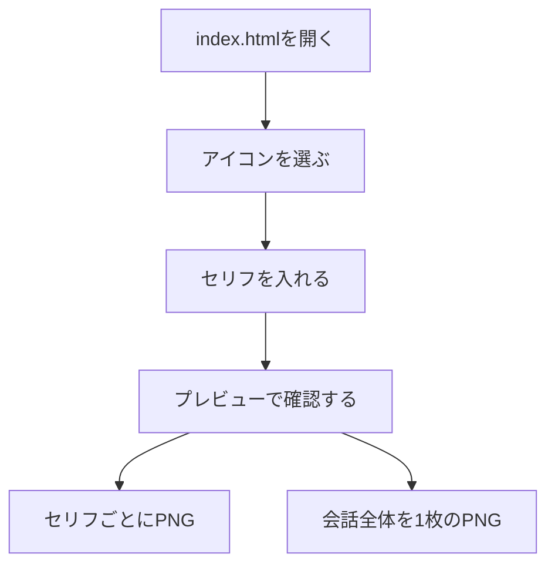

# 設計書

状態: **Accepted**

## 目的

noteの本文には吹き出しがありません。記事に、二人の掛け合いを画像として貼れるようにします。

## 利用者

記事を書く人です。読み手は、保存したPNGをnote上で見ます。

## 形

アプリは `index.html` の1ファイルです。ブラウザで開いて動き、インストールしません。セリフ、アイコン、画像の生成は、開いているブラウザの中だけで行います。

## 話し手

| 話し手 | 位置 | 吹き出し | 枠 | 名前の色 | アイコンが無いとき |
| --- | --- | --- | --- | --- | --- |
| わたし（初期値。右側） | 右。アイコンも右 | 白 `#FFFFFF` | 緑 `#4E7A3F`、太さ3px | `#3e6432` | 名前の先頭1文字。初期値は「わ」 |
| メェ助（初期値。左側） | 左。アイコンも左 | クリーム `#FFFBF0` | 金 `#C99A3E`、太さ3px | `#6e4f1c` | 名前の先頭1文字。初期値は「メ」 |

名前は画面で変えられます。初期値は右側が「わたし」、左側が「メェ助」です。変えた名前は吹き出しと、まとめて貼るときの行頭に使います。空にすると初期値に戻ります。二人の名前は別です。12文字を超える分は切り詰めます。色と左右は変わりません。名前を変えても、ファイル名の `watashi` と `meesuke` はその左右の役割のままです。まとめて貼る行頭は、いま名前欄にある文字列だけです。初期値の「わたし：」「メェ助：」は、名前を変えたあとは読みません。

アイコンは円に切り抜き、金 `#C99A3E` の縁（2.5px）を付けます。名前はアイコンの下、16pxです。列に収まらないときは11pxまで小さくします。しっぽは話し手の側に付く小さな三角です。吹き出しの角は丸めます。

## 画面

上から、使い方3行、アイコン、セリフ、まとめて貼る、書き出しです。広い画面では、書き出しとプレビューを右に固定します。狭い画面では縦に積み、ボタンの高さを44px以上にします。

## 入力

- 1行は80文字まで。改行はセリフの区切りではなく、吹き出しの幅で折り返します。
- まとめて貼る欄は、行頭の表示名と、全角または半角のコロンで話し手を決めます。初期値は「わたし」と「メェ助」です。
- 初めて開いたときは記入例を出します。編集すると、その内容をブラウザに残します。

## 出力

- 横幅800px。本文の文字は30px。行間の追加は14px。
- 背景は透明、または薄い緑 `#DCEBD2`。
- 1枚の高さはセリフの量で変わります。会話全体が16384pxを超えるときは、1枚にまとめず、セリフごとに保存するよう知らせます。
- ファイル名は `serif_01_meesuke.png`、`serif_02_watashi.png`、会話全体は `serif_all.png` です。番号は空行を除いた順です。

## ブラウザへの保存

| キー | 中身 |
| --- | --- |
| `serif-bubble-icons-v1` | アイコン画像 |
| `serif-bubble-lines-v1` | セリフ |
| `serif-bubble-prefs-v1` | 画像の分け方、背景、二人の表示名 |

保存に失敗しても、開いているあいだの表示は続けます。

## 文字

Zen Maru Gothic（太さ500、SIL Open Font License 1.1）を同梱します。読めないときは、ヒラギノ丸ゴ、游ゴシック、メイリオの順です。

## やらないこと

- 外部への通信。ページの接続先は `connect-src 'none'` です。
- noteへの投稿、会員登録、絵文字による装飾。
